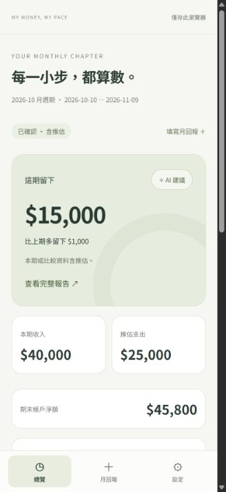
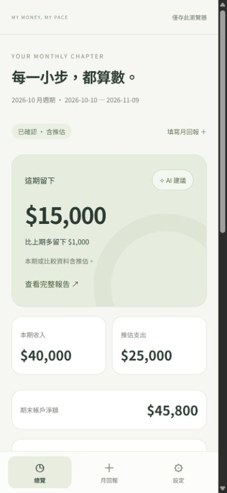

# 月存 MoonSave ☾

**每個發薪日，花幾分鐘看懂財務進步，決定下一步。**

[公開體驗版](https://eric02-ch.github.io/moonsave/) · [私人雲端版](https://moonsave-cloud-eric02.b0965160656.chatgpt.site) · [自動檢查](https://github.com/Eric02-ch/moonsave/actions) · v1.0.0

月存是一個手機優先的薪資週期財務回報 PWA。它來自「每月與 AI 回顧財務」的實際需求：把輸入、確認、歷史比較做成能持續使用的產品。v1 聚焦月回顧，AI 建議稍後啟用。



<details>
<summary>手機畫面</summary>

</details>

## 使用流程

1. 設定發薪日、固定盤點帳戶及一個儲蓄目標；各信用卡可分別設定結帳日與繳款日。
2. 回報剛結束週期的收入與帳戶餘額。發薪日 10 日時，11/10 結算 10/10～11/9，新薪資歸下一期。
3. 有連續可比較資料時，系統協助推估支出；也能直接填入既有記帳整理的實際總額。
4. 檢查確認頁，接受推估或返回修改，再正式儲存。
5. 看 Dashboard、完整報告與歷史趨勢，選填下期想改善的一件事。

## v1 功能

- **三頁介面**：總覽、月回報、設定；完整報告與儲存前確認由主要頁面進入。
- **薪資週期**：自動預設最近結束週期，切換補填；短月份發薪日採月底，歷史週期保留。
- **自訂帳戶**：新增、改名、分類、封存；信用卡記錄全部未繳款，包含未出帳。歷史保留快照；編輯回報可選擇套用新清單。
- **支出推估**：連續兩期期末淨額、收入及特殊資金調整；首次只建基準，缺資料或盤點範圍改變時不推估。
- **餘額回推**：可填期末或目前餘額；目前值須逐帳戶確認新一期全部變動，才能回推上期期末，無法確認不混算。
- **確認後儲存**：正式儲存前核對收支及帳戶；支出清楚標明實際或推估，確認估值不會變成實際支出。
- **草稿與修改**：輸入有效內容時暫存，依週期分開；同一期單份回報，可編輯或確認後刪除。前期依據變動會撤銷後期推估的有效狀態。
- **目標與行動**：一個指定帳戶餘額型目標，提領後進度下降；每期一個選填行動，下一期帶出回顧。
- **備份與相容**：JSON 匯出、匯入，包含草稿、歷史行動與舊資料。v0.2 舊月份不自動對應新薪資週期，可由使用者確認後帶入草稿。
- **私人雲端**：既有私人登入、D1 帳號隔離、版本衝突保護、離線本機快取與重試；舊客戶端不能降版覆蓋新版資料。
- **PWA**：Manifest、更新後的 Service Worker；已快取的本機功能可離線使用，登入與雲端同步仍需要網路。

本版沒有每日記帳、銀行自動串接、投資行情、完整資產管理或公開多人雲端註冊。AI 入口顯示尚未啟用，前端不傳送財務資料給模型。

## 數字怎麼算

| 指標 | 定義 |
| --- | --- |
| 帳戶淨額 | 已盤點資產合計 − 已盤點信用卡未繳款 |
| 推估支出 | 本期收入 ＋ 非收入／非消費淨流入 − 期末與期初帳戶淨額差 |
| 本期結餘 | 收入 − 使用者填入或確認推估的支出 |
| 目標進度 | 指定帳戶最近有效盤點餘額 ÷ 目標金額 |

例如收入 40,000、淨額增加 5,000、另轉出 10,000 到未盤點的投資帳戶，推估支出為 25,000。自己已盤點帳戶間轉帳與繳卡費不重複列支出或調整。

推估依賴完整資料。現金、電子錢包、卡債漏列，或投資估值混入，都可能讓結果失真。負推估不截成 0；無法釐清時改填實際總額。帳戶淨額變化與本期結餘分開呈現，兩者都不等於完整淨資產成長。

## 本機開發

需要 Node.js 24+，前端無第三方執行期依賴。

```bash
git clone https://github.com/Eric02-ch/moonsave.git
cd moonsave
npm run dev
npm test
npm run build
```

開啟終端機顯示的本機網址。公開體驗版使用虛構資料，資料僅留在目前瀏覽器。PowerShell 若阻擋 npm.ps1，可改用 npm.cmd。

```text
public/main.js       介面、回報流程、草稿與備份
public/finance.js    v1 資料驗證、薪資週期、推估與失效規則
public/core.js       舊版計算、備份相容及新版驗證入口
public/sync.js       帳號同步、修訂版本與重試
public/theme.css     手機優先版型、安全區與三項導覽
public/sw.js         本機 App 快取，不快取 API
cloud/               私人雲端後端與部署來源副本
scripts/             靜態建置與共用前端同步
test/                計算、遷移、HTTP 及同步回歸測試
docs/                spec、驗證紀錄及虛構資料截圖
```

前端以 public/ 為唯一編輯來源，更新私人版副本執行 `npm run sync:frontend`。私人版建置及部署另見 [cloud/README.md](cloud/README.md)。GitHub Actions 在 main 更新後測試並部署公開體驗版。

舊 app.js、styles.css 與本機 AI 代理保留供版本相容參考，新入口為 main.js。既有 AI 代理只接受舊格式，v1 介面沒有啟用它；設定金鑰不會啟用新版 AI，勿直接公開該代理。

## 資料與隱私

- 公開 GitHub 僅放程式碼、規格及虛構資料截圖。真實回報、私人備份、憑證及正式資料庫內容不提交。
- 公開版使用 localStorage 的 moonsave.v1，內部資料 schema 為 version 3；舊鍵名保留以便遷移。私人快取使用 moonsave.v1.user.<登入識別>，依帳號區分。
- 私人版保留既有登入權限，資料同步到私人 D1；不是端對端加密產品，共用裝置需管理登入與瀏覽器資料。
- 更換瀏覽器、網域、通訊埠或清除網站資料前，請先匯出備份。JSON 內含財務資訊，請私下保存。
- 不載入外部字型或追蹤分析服務。AI 尚未啟用，沒有付費模型請求。
- 資料讀取失敗時停止介面寫入，提供原始資料匯出；同步衝突時先備份再選擇載入雲端。

## 驗證與後續

已以自動化測試驗證計算、備份、同步及舊版保護；以瀏覽器操作走完推估、確認、儲存及報告流程，並檢查手機尺寸。桌面模擬不等於實體 iPhone Safari 已通過，鍵盤及安全區仍需實機驗收。

規格：[產品 v1 規劃](docs/product-spec-v0.3.md)。開發差異與限制見 [v1 驗證紀錄](docs/verification-v1.md)。

後續優先：實機操作回饋、減少月末整理負擔、具預算與資料同意流程的 AI 回顧，以及品牌網址。銀行自動匯入與完整資產管理另行規劃。
